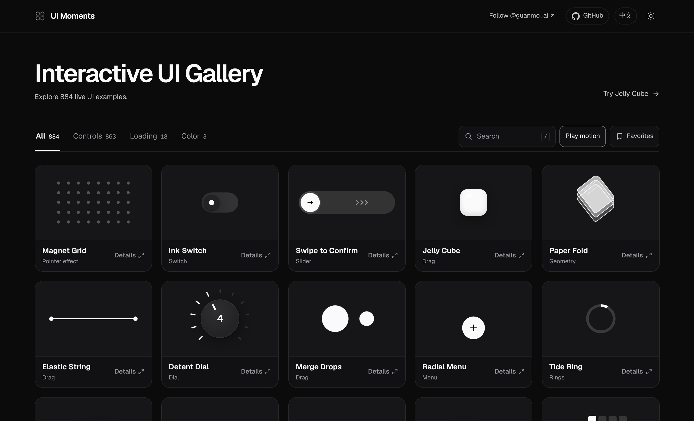

<p align="right"><strong>English</strong> · <a href="README.zh-CN.md">简体中文</a></p>

# UI Moments · Interactive UI Gallery

UI Moments is a hands-on gallery of interactive UI and motion, maintained by 观默 (Guanmo). The first release has 884 examples, and every card is live.

## What's in the gallery

| Category | Examples |
| --- | --- |
| [Core controls](gallery/originals/index.html) | Ink Switch, Detent Dial, Hold to Confirm, Odometer Stepper, Leaf Tabs, Tide Progress |
| [Visual interactions](gallery/originals/visual.html) | Magnet Grid, Jelly Cube, Merge Drops, Ripple Pad, Bloom Toggle |
| [Gestures and physics](gallery/originals/gestures.html) | Swipe to Confirm, Pull to Refresh, Elastic String, Domino Row, Rocker Switch, Scrub Wave, Snap Grid, Radial Menu, Step Track, Breath Orb |
| [Action feedback](gallery/originals/actions.html) | Copy Button, Like Burst, Paper Plane Send, Download Ring, Code Shake, Bell Toggle |
| [Form inputs](gallery/originals/inputs.html) | Stroke Checklist, Pebble Rating, Notch Slider, Strength Meter, Chip Input, Plan Picker |
| [Color controls](gallery/originals/color.html) | Hue Orbit, Pull Cord Lamp, Flip Coin |
| Original loaders | Paper Fold, Signal Return, and 16 other loaders with adjustable parameters and HTML or JSX export |
| Component examples | 830 live examples covering drawers, forms, menus, data grids, charts, schedules, code editors, and more |



## Reuse an example

Open a card's details and select **Copy prompt** for its link, exact source file or entry point, and local setup instructions. You can also open source files from the details.

| Examples | How to reuse |
| --- | --- |
| Ink Switch, Detent Dial, Jelly Cube | Copy or download the standalone HTML and open it offline |
| Other original controls | Copy the demo page for the selected control, then extract that control with its styles and script |
| Original loaders | Adjust size, color, and duration. Open the HTML offline or use the JSX in React |
| Component examples | Build locally and use the details to find the example code, locked dependencies, and license |

## Run locally

Clone the Git repository. You need Node.js 22.18+ or 24.11+, npm, and Python 3.

```sh
npm run setup
npm run build
npm run package:site
python3 -m http.server 5173 --bind 127.0.0.1 --directory _site
```

Open [http://127.0.0.1:5173](http://127.0.0.1:5173). Use `_site/` as the static site output.

For a fork or another branch, set `UI_MOMENTS_REPOSITORY` to the full GitHub repository URL and `UI_MOMENTS_REF` to the branch, tag, or commit when running `npm run package:site`. Source, contributing, and credits links will point to that revision.

## Browser tests

```sh
npx playwright install --only-shell chromium firefox webkit
npm test
npm run test:cards
```

Run `UI_MOMENTS_CARD_CPU_RATE=4 npm run test:cards` to simulate a 4× CPU slowdown in Chromium. Throttled runs use at most two pages in parallel. CI runs with a 2× slowdown.

## Maintenance and license

UI Moments is maintained by 观默 (Guanmo). Project code is licensed under MIT. Some component examples are built on open-source component libraries. Third-party code and fonts keep their own copyright notices and licenses; see [CREDITS.md](CREDITS.md).

[Contributing](CONTRIBUTING.md) · [MIT license](LICENSE) · [Third-party credits](CREDITS.md) · [Guanmo](https://x.com/guanmo_ai)
