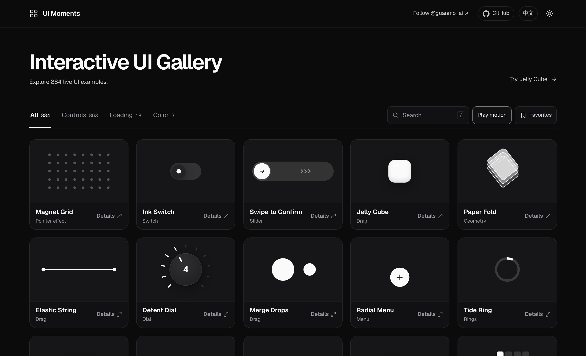

<p align="right"><a href="README.md">English</a> · <strong>简体中文</strong></p>

# UI Moments · 界面图鉴

UI Moments 是一个可以直接上手的界面交互与动效图鉴，由观默维护。首发收录 884 个示例，卡片打开即可操作。

## 图鉴内容

| 分类 | 控件 |
| --- | --- |
| [基础控件](gallery/originals/index.html) | 墨滴开关、刻度旋钮、长按确认、滚轮步进器、翻页标签、潮汐进度 |
| [图形交互](gallery/originals/visual.html) | 磁吸点阵、果冻方块、融合水滴、涟漪画板、花朵开关 |
| [手势与物理](gallery/originals/gestures.html) | 滑动确认、下拉刷新、弹弦、多米诺、翘板开关、波形拖动、吸附网格、扇形菜单、步骤条、呼吸球 |
| [操作反馈](gallery/originals/actions.html) | 复制按钮、点赞爆发、纸飞机发送、下载进度环、验证码输入、通知铃 |
| [表单输入](gallery/originals/inputs.html) | 划线清单、石子评分、档位滑块、密码强度、标签输入、方案卡片 |
| [多彩控件](gallery/originals/color.html) | 色轮、拉绳灯、抛硬币 |
| 原创加载动效 | 纸张折叠、信号回转及 16 款加载动效。支持调参和导出 HTML 或 JSX |
| 组件示例 | 抽屉、表单、菜单、数据表格、图表、日程、代码编辑等 830 个可交互示例 |



## 复用一个示例

打开卡片详情，使用 **复制提示词（Copy prompt）** 获取示例链接、具体源文件或示例入口，以及本地复现方式。控件详情也可以直接打开源文件。

| 示例 | 复用方式 |
| --- | --- |
| 墨滴开关、刻度旋钮、果冻方块 | 复制或下载独立 HTML，保存后可离线运行 |
| 其余原创控件 | 复制包含所选控件的完整演示页，集成时从中提取该控件及它的样式和脚本 |
| 原创加载动效 | 调整尺寸、颜色和时长。HTML 可离线运行，JSX 可在 React 项目中使用 |
| 组件示例 | 按下方命令构建本地示例，从详情定位代码、锁定版本和许可 |

## 本地运行

从 Git 克隆项目后运行以下命令。需要 Node.js 22.18+ 或 24.11+、npm 和 Python 3。

```bash
npm run setup
npm run build
npm run package:site
python3 -m http.server 5173 --bind 127.0.0.1 --directory _site
```

打开 [http://127.0.0.1:5173](http://127.0.0.1:5173)。部署静态站点时使用 `_site/`。

从 fork 或审核分支打包时，可给 `npm run package:site` 设置 `UI_MOMENTS_REPOSITORY`（GitHub 仓库完整地址）和 `UI_MOMENTS_REF`（分支、标签或提交）。站点的源码、贡献和署名链接会指向对应版本。

## 浏览器测试

```bash
npx playwright install --only-shell chromium firefox webkit
npm test
npm run test:cards
```

用 `UI_MOMENTS_CARD_CPU_RATE=4 npm run test:cards` 可在 Chromium 中模拟 4 倍 CPU 降速。降速时最多并行检查两个页面，CI 使用 2 倍降速。

## 维护与许可

UI Moments 由观默维护，项目代码采用 MIT 许可。部分组件示例基于开源组件库构建，第三方代码与字体保留各自的版权和许可证，详见 [CREDITS.md](CREDITS.md)。

[贡献指南](CONTRIBUTING.md) · [MIT 许可证](LICENSE) · [第三方署名](CREDITS.md) · [观默](https://x.com/guanmo_ai)
